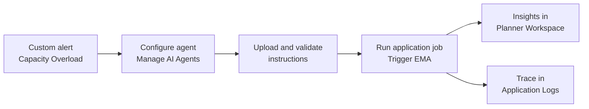

<!-- TODO: replace <SESSION-ID> with the TechEd session ID in the title, Description and Overview. -->
# <SESSION-ID> - Hands-On: Exception Management Agent (EMA) in SAP IBP

## Description

This repository contains the material for the SAP TechEd 2026 session called <SESSION-ID> - Hands-On: Exception Management Agent (EMA) in SAP IBP.

## Overview

This session introduces attendees to the Exception Management Agent (EMA 2.0) in SAP Integrated Business Planning (SAP IBP). EMA is a system-triggered agent: it picks up planning alerts, performs root-cause analysis, and writes insights and mitigation proposals back to SAP IBP. The planner stays in control of every decision.

In the exercises you play a supply planner facing a Capacity Overload alert. You configure an agent, validate its instructions, run it with an application job, review the insights in your planner workspace, and trace the run in the application logs.

## Requirements

The requirements to follow the exercises in this repository are:

- A laptop with a current web browser.
- An SAP IBP user (PLANNER_XX) and system URL, provided by the session team. XX is the number on your desk card.
- The agent instruction files for Exercises 3 and 4, provided on your desktop.
- Basic familiarity with SAP IBP planner workspaces and key figures.

<!-- TODO: replace "provided on your desktop" with a link to the files once they are in this repo (for example exercises/ex3/files/). -->

## Exercises

### Exception Management Agent (EMA, system-triggered in SAP IBP)

- [Getting Started](exercises/ex0/)
- [Exercise 1 - Meet the alert](exercises/ex1/)
- [Exercise 2 - Configure your agent](exercises/ex2/)
- [Exercise 3 - Upload and validate the agent instructions](exercises/ex3/)
- [Exercise 4 - What went wrong?](exercises/ex4/)
- [Exercise 5 - Run the agent](exercises/ex5/)
- [Exercise 6 - Review the insights](exercises/ex6/)
- [Exercise 7 - Trace the run](exercises/ex7/)
- [Exercise 8 - Bonus exercises](exercises/ex8/)
    - [Exercise 8.1 - Change how the alert is analysed](exercises/ex8#exercise-81-change-how-the-alert-is-analysed)
    - [Exercise 8.2 - The packing line](exercises/ex8#exercise-82-the-packing-line)

### Product Structure Optimizer Agent (interactive, in Joule)

This is a separate, self-contained track that shows how to work with the Product Structure Optimizer Agent (`@Product Design Assistant`) in Joule to create and manage a Bill of Materials (BOM).

- [Getting Started - Product Structure Optimizer Agent](exercises/pso/ex0/)
- [Exercise 1 - Create a BOM from a file](exercises/pso/ex1/)
- [Exercise 2 - Run sanity checks and enrich the BOM](exercises/pso/ex2/)
- [Exercise 3 - Summarize, explode, and delete the BOM](exercises/pso/ex3/)

### Product Data Maintenance Agent (interactive, in Joule)

This is a separate, self-contained track that shows how to work with the Product Data Maintenance Agent in Joule to create and maintain product master data in bulk.

- [Getting Started - Product Data Maintenance Agent](exercises/pdm/ex0/)
- [Exercise 1 - Discover capabilities and create products from a file](exercises/pdm/ex1/)
- [Exercise 2 - Extend products to a plant and classify them](exercises/pdm/ex2/)
- [Exercise 3 - Search by classification, add German descriptions, and verify](exercises/pdm/ex3/)

**IMPORTANT**

Your repo must contain the .reuse and LICENSES folder and the License section below. DO NOT REMOVE the section or folders/files. Also, remove all unused template assets(images, folders, etc) from the exercises folder.

## Contributing
Please read the [CONTRIBUTING.md](./CONTRIBUTING.md) to understand the contribution guidelines.

## Code of Conduct
Please read the [SAP Open Source Code of Conduct](https://github.com/SAP-samples/.github/blob/main/CODE_OF_CONDUCT.md).

## How to obtain support

Support for the content in this repository is available during the actual time of the online session for which this content has been designed. Otherwise, you may request support via the [Issues](../../issues) tab.

## License
<!-- TODO: replace <your-project> with the repository name (twice). -->
Copyright (2026-)2026 SAP SE or an SAP affiliate company and <your-project> contributors. Please see our [LICENSE](LICENSE) for copyright and license information. Detailed information including third-party components and their licensing/copyright information is available [via the REUSE tool](https://api.reuse.software/info/github.com/SAP/<your-project>).
