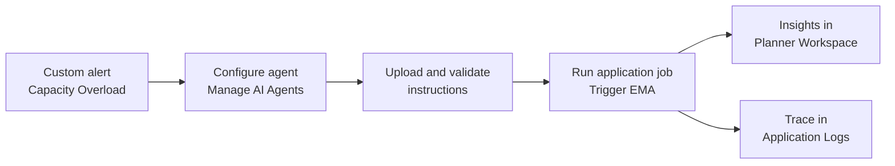
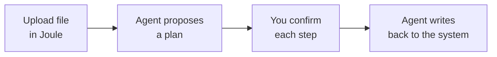

# AS262 - Explore autonomous product design and supply chain planning

`Hands-on workshop`

## Description

This repository contains the material for the SAP TechEd 2026 session called AS262 - Explore autonomous product design and supply chain planning. It covers two tracks: the Exception Management Agent (EMA) in SAP IBP and the Product Design Assistant in Joule.

## Overview

This session introduces attendees to two different kinds of AI agents. The exercises are organised into two independent tracks, and you can follow either one on its own:

### 1. Exception Management Agent (EMA) - system-triggered in SAP IBP

The Exception Management Agent (EMA 2.0) in SAP Integrated Business Planning (SAP IBP) is a *system-triggered* agent: it picks up planning alerts, performs root-cause analysis, and writes insights and mitigation proposals back to SAP IBP. The planner stays in control of every decision.

In this track you play a supply planner facing a Capacity Overload alert. You configure an agent, validate its instructions, run it with an application job, review the insights in your planner workspace, and trace the run in the application logs.

### 2. Product Design Assistant - interactive in Joule

The `@Product Design Assistant` is an *interactive* agent: you talk to it in **Joule** and drive every step of the conversation, keeping the human in the loop. This track covers two scopes:

- **Product Structure Optimizer** - create and manage a Bill of Materials (BOM): extract a BOM from a file, run sanity checks, enrich it with predicted components and values, then summarize, explode, and delete it.
- **Product Data Maintenance Agent** - create and maintain product master data in bulk: create products from an Excel file, extend them to a plant, classify them, search them by classification, and add translated descriptions.

## Requirements

The requirements to follow the exercises in this repository are:

- A laptop with a current web browser.
- Basic familiarity with SAP IBP (for the EMA track) or product master data concepts such as BOMs and classification (for the Product Design Assistant track).

For the **Exception Management Agent (EMA)** track:

- An SAP IBP user (PLANNER_XX) and system URL, provided by the session team. XX is the number on your desk card.
- The agent instruction files for Exercises 3 and 4, provided on your desktop.

For the **Product Design Assistant** track:

- A Joule user (sarah.davisX@bestrunsap.com) and system URL, provided by the session team. X is the number on your desk card.
- The `@Product Design Assistant` available when you start a new conversation in Joule.
- The sample upload files referenced in each exercise (BOM file for the Product Structure Optimizer, Excel product file for the Product Data Maintenance Agent).

<!-- TODO: replace "provided on your desktop" with a link to the files once they are in this repo (for example exercises/ex3/files/). -->

## Exercises

The exercises are split into two independent tracks. Pick either one, or do both.

### Exception Management Agent (EMA, system-triggered in SAP IBP)

- [Getting Started](exercises/ex0/)
- [Exercise 1 - Meet the alert](exercises/ex1/)
- [Exercise 2 - Configure your agent](exercises/ex2/)
- [Exercise 3 - Upload and validate the agent instructions](exercises/ex3/)
- [Exercise 4 - What went wrong?](exercises/ex4/)
- [Exercise 5 - Run the agent](exercises/ex5/)
- [Exercise 6 - Review the insights](exercises/ex6/)
- [Exercise 7 - Trace the run](exercises/ex7/)
- [Exercise 8 - Bonus exercises](exercises/ex8/)
    - [Exercise 8.1 - Change how the alert is analysed](exercises/ex8#exercise-81-change-how-the-alert-is-analysed)
    - [Exercise 8.2 - The packing line](exercises/ex8#exercise-82-the-packing-line)

### Product Design Assistant (interactive, in Joule)

These exercises show how to work with the `@Product Design Assistant` in Joule. They cover two scopes: the Product Structure Optimizer, for creating and managing a Bill of Materials (BOM), and the Product Data Maintenance Agent, for creating and maintaining product master data in bulk.

**Product Structure Optimizer**

- [Getting Started - Product Structure Optimizer Agent](exercises/pso/ex0/)
- [Exercise 1 - Create a BOM from a file](exercises/pso/ex1/)
- [Exercise 2 - Run sanity checks and enrich the BOM](exercises/pso/ex2/)
- [Exercise 3 - Summarize, explode, and delete the BOM](exercises/pso/ex3/)

**Product Data Maintenance Agent**

- [Getting Started - Product Data Maintenance Agent](exercises/pdm/ex0/)
- [Exercise 1 - Discover capabilities and create products from a file](exercises/pdm/ex1/)
- [Exercise 2 - Extend products to a plant and classify them](exercises/pdm/ex2/)
- [Exercise 3 - Search by classification and add German descriptions](exercises/pdm/ex3/)

## Contributing
Please read the [CONTRIBUTING.md](./CONTRIBUTING.md) to understand the contribution guidelines.

## Code of Conduct
Please read the [SAP Open Source Code of Conduct](https://github.com/SAP-samples/.github/blob/main/CODE_OF_CONDUCT.md).

## How to obtain support

Support for the content in this repository is available during the actual time of the online session for which this content has been designed. Otherwise, you may request support via the [Issues](../../issues) tab.

## License
<!-- TODO: replace <your-project> with the repository name (twice). -->
Copyright (2026-)2026 SAP SE or an SAP affiliate company and <your-project> contributors. Please see our [LICENSE](LICENSE) for copyright and license information. Detailed information including third-party components and their licensing/copyright information is available [via the REUSE tool](https://api.reuse.software/info/github.com/SAP-samples/teched2026-AS262).
