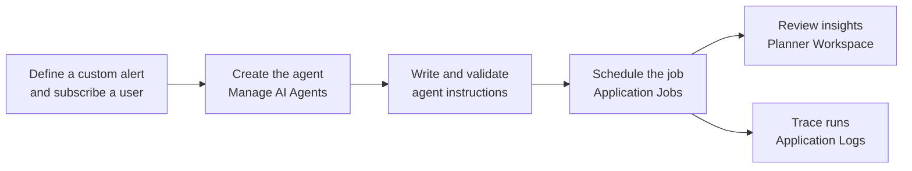

# Exception Management Agent (EMA) in SAP IBP

> EMA runs a customer's own alert-handling instructions deterministically, and uses an LLM only for reasoning.

The Exception Management Agent (EMA 2.0) is a system-triggered AI agent in SAP Integrated Business Planning (SAP IBP). It picks up planning alerts, performs the root-cause analysis the customer has defined, and writes insights and mitigation proposals back to the planner's workspace. Planners stay in control of every decision. EMA takes over the searching, correlating and triage work that fills most of a planner's day.

This page accompanies the EMA part of session AS262, which is presented as a live demo. There are no hands-on exercises for EMA in this repository.

**On this page**

- [The problem: too many alerts, too little time](#the-problem-too-many-alerts-too-little-time)
- [What EMA does](#what-ema-does)
- [Use case: a capacity overload](#use-case-a-capacity-overload)
- [Architecture: the trust model](#architecture-the-trust-model)
- [How EMA is set up in SAP IBP](#how-ema-is-set-up-in-sap-ibp)
- [Roadmap](#roadmap)
- [Frequently asked questions](#frequently-asked-questions)

## The problem: too many alerts, too little time

An exception in a supply chain is a shortage, a capacity overload, or demand that cannot be fulfilled. SAP IBP raises an alert whenever the plan breaks a rule the customer has defined.

Planners live in this alert list. Alerts are split by country, product, location and other dimensions, and planners triage them by hand. The real difficulty is volume against time:

- **One root cause, many alerts.** A single missing component can raise hundreds of alerts across the products and locations that depend on it.
- **About a minute per alert.** Take 7 planners who have 3 hours to work through 1,000 alerts. That leaves roughly one minute of planner time per alert.
- **The procedure is not trivial.** Customers resolve an alert by following their own procedure: read these key figures, check this lead time, compare against that capacity. A real procedure easily has a dozen steps with several decision points.

A minute is not enough to follow such a procedure. Alerts get skimmed, deferred, or closed without analysis.

## What EMA does

EMA follows the customer's own procedure for every alert, so that the planner starts from an analysis instead of a raw alert.

| Capability | What it means |
| --- | --- |
| Custom alerts | EMA works on the custom alerts customers already define in SAP IBP. Each agent is linked to a planning area, an alert subscription, and a business user. |
| Customer-defined instructions | Every alert type gets its own analysis procedure, written as agent instructions. Two customers can resolve a similar alert in different ways, and so can two teams in one organisation. |
| Root-cause analysis | For each alert, EMA runs the instructions against live planning data and works out why the rule was broken. |
| Insights and proposals | The result is stored in SAP IBP as an insight with a mitigation proposal, shown in the planner workspace next to the data it refers to. |
| Planner feedback | Planners rate each proposal with a thumbs up or thumbs down, which helps improve future proposals. |
| Traceability | Every run is logged in the SAP IBP application logs, step by step. |

## An example use case: a capacity overload

A supply planner has a Capacity Overload alert defined as *Capacity Consumption (%) greater than 100* over a 12-week horizon. The alert fires on an assembly resource in calendar week 36.

| Without EMA | With EMA |
| --- | --- |
| The planner opens the alert, then the worksheet, and looks up consumption and available capacity for the week. | The scheduled agent run reads consumption and available capacity for that resource and week. |
| The planner works out the gap by hand, then checks which products drive the load. | The generated code computes the gap: 2,627 minutes required against 1,600 minutes available, so 1,027 minutes too much. |
| The planner decides what to do, often under time pressure and alert by alert. | The planner reads an insight that explains the overload and proposes how to close the gap, checks the numbers in the worksheet, and decides. |

The planner's role changes from finding the problem to judging the proposed answer.

## Architecture: the trust model

A planning agent is only useful if planners can trust its numbers. EMA is designed around one rule: **the numbers come from deterministic code, and the language model only explains them.**

The work is split between design time, which happens once per set of instructions, and runtime, which happens for every alert.
[Trust Model](images/tm.jpg)
Each stage adds one guarantee:

| Stage | Guarantee |
| --- | --- |
| **Instruction Wizard** | Instructions are written in a closed grammar. Only the steps the domain-specific language (DSL) defines are allowed, so free-form code cannot be entered. |
| **DSL JSON** | The instructions are stored as JSON, checked against the schema, and scanned before anything is generated. |
| **ABAP generator** | ABAP code is generated once from the instructions. The generated code is not editable, so what runs is exactly what was validated. |
| **Validate** | Before the agent goes live, the instructions run as a smoke test on real planning data. A validation report shows the flowchart, the test result, and the generated class. |
| **Application job** | The agent runs as a standard SAP IBP application job, under standard ABAP authorizations. It sees only the data its business user may see. |
| **ABAP computes** | All reading, counting, summing and comparing is done by the generated code. The same input always gives the same result. |
| **LLM explains** | The language model receives the computed results and writes the explanation and proposal. It does not calculate the numbers. |
| **Planner decides** | The insight comes with an execution trace. The planner sees what was computed, why it was proposed, and makes the decision. |

## How EMA is set up in SAP IBP

Setting up EMA uses standard SAP IBP apps. No coding is required.

1. **Define the alert.** In *Define and Subscribe to Custom Alerts*, define the alert rule and subscribe the business user the agent will run as.
2. **Create the agent.** In *Manage AI Agents*, create an agent and assign the business user, the planning area, and the alert subscription.
3. **Write and validate the instructions.** Create the agent instructions with the Instruction Wizard, or upload them as JSON, then validate them and review the validation report.
4. **Schedule the job.** In *Application Jobs*, schedule the job template *Trigger Exception Management AI Agent* for the planning area and alert subscription. In production, the job typically recurs after each planning run.
5. **Review the insights.** Planners see the insights in the Exception Management panel of their planner workspace, next to the data the alert refers to.
6. **Trace the runs.** Each run is logged in the SAP IBP application logs.

## Roadmap

> [!IMPORTANT]
> This is the current state of planning and can be changed by SAP at any point in time.

### Exception Management Agent

Each stage builds on the one before it, and each moves to the next only when the previous one has proven itself.

| Stage | Capability | What it adds |
| --- | --- | --- |
| Today: generally available | **Analyse and recommend** | Agent Instruction Wizard and data-driven insights for each alert. |
| In design | **Root-cause clustering** | Groups alerts that share a root cause, and produces one root-cause analysis per cluster instead of one per alert. |
| Exploratory | **Write-back to a scenario** | The agent writes its proposals into a single planning scenario, resolving root causes before their downstream effects. |

## Frequently asked questions

**Does the language model calculate the numbers in an insight?**
No. All figures are computed by ABAP code generated from the agent instructions. The language model receives those figures and turns them into an explanation and a proposal.

**Can EMA change my plan on its own?**
No. Today, EMA analyses and recommends. The planner decides whether to act on a proposal.

**Can every customer analyse an alert differently?**
Yes. The analysis is defined per alert in the agent instructions, so each organisation encodes its own procedure.

**What data can the agent see?**
The agent runs as an application job under a business user, with standard SAP IBP authorizations. It sees the data that user is authorized to see, in the planning areas assigned to the agent.

**How do I know why the agent proposed something?**
Every insight comes with an execution trace, and every run is logged in the application logs.

## Presenters

- Domnic Savio Benedict, Lead Architect, Exception Management Agent, SAP IBP
- Sandro Schiefner, Developer, Exception Management Agent, SAP IBP

### [SAP Help](https://help.sap.com/docs/AUTONOMOUS_SCM_DOMAIN/5fefd1d4a6e1430d83f324708220e909/00b81afc7e80405e824d409985a6b83e.html)

---

[Back to the session overview](../README.md)
