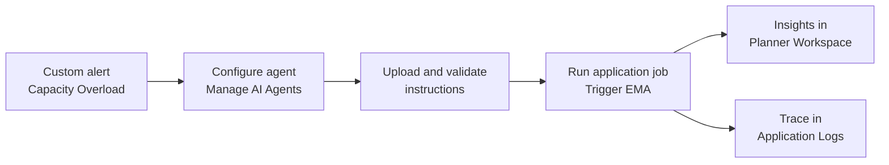

# Getting Started

In this session, you will use the Exception Management Agent (EMA 2.0) for the first time: you configure it, validate its instructions, run it, and review the insights it writes back to SAP IBP.

## Session details

<!-- TODO: fill in session ID, date and room, and the system URL. -->

| Item | Value |
| --- | --- |
| Event | SAP TechEd Berlin 2026, hands-on session (session ID: TBD) |
| Date and room | TBD |
| SAP IBP system | myXXXXXX (URL: TBD) |
| Your user | PLANNER_XX, where XX is the number on your desk card |
| Planning area | HPAEMAGENT |
| Planner workspace | PWS for Supply Planner (TechEd 2026) |
| Alert definition | Capacity Overload |

> [!IMPORTANT]
> During the hands-on session, only create or change objects that carry your assigned number. Do not edit, copy or delete the shared alert definition, the planner workspace, or other participants' agents.

## Scenario

You are a supply planner. Your Capacity Overload alert fires when Capacity Consumption (%) on a resource goes above 100% within a 12-week horizon, and it is firing on the assembly and packing lines of location CN1310. Instead of digging through key figures yourself, you let EMA do the root-cause analysis and propose a mitigation. You stay in control: EMA proposes, you decide.

EMA is system-triggered. You describe how an alert should be analysed (the agent instructions), EMA validates them at design time, and an application job runs them at runtime. The results land as insights in your planner workspace.

The exercises follow this flow from left to right. Exercises 1 to 4 are design time, Exercises 5 to 7 are runtime.

## Summary

You now know the scenario, your user, and the objects you will work with.

Continue to - [Exercise 1 - Meet the alert](../ex1/README.md)
