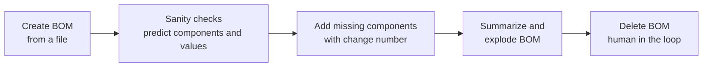

# Getting Started - Product Structure Optimizer Agent

In this track, you will use the **Product Structure Optimizer Agent** for the first time. Unlike the Exception Management Agent (EMA), which is triggered by a system job, this agent is *interactive*: you talk to it in **Joule** through the `@Product Design Assistant`, and you drive every step of the conversation.

Over three exercises you create a Bill of Materials (BOM) from a file, run sanity checks and enrich it with predicted components and values, and finally summarize, explode, and delete it - always keeping the human in the loop.

> [!NOTE]
> This is a separate track from the Exception Management Agent (EMA) exercises. You do not need to have completed the EMA exercises to follow along here.

## Session details

<!-- TODO: fill in the room, and the system URL. -->

| Item | Value |
| --- | --- |
| Event | SAP TechEd Berlin 2026, hands-on session (session ID: AS262) |
| Date and room | Wednesday, Oct 28, 3:30 PM - 5:30 PM CET (room: TBD) |
| System | myXXXXXX (URL: TBD) |
| Your user | PLANNER_XX, where XX is the number on your desk card |
| Assistant | `@Product Design Assistant` (Product Structure Optimizer Agent) in Joule |

## Prerequisites

Before you start, make sure that:

- **Joule** is enabled and reachable for your user.
- The `@Product Design Assistant` is available when you start a new conversation.
- You have the sample BOM file to upload in Exercise 1.
  <!-- TODO: confirm the exact file name, format (for example .xlsx, .csv or .pdf) and where participants find it, then link it from exercises/pso/ex1/files/. -->

> [!IMPORTANT]
> During the hands-on session, only create, change or delete the BOM that you create yourself. Do not touch BOMs created by other participants.

## Scenario

You are a product designer. Instead of assembling a Bill of Materials by hand, you let the Product Structure Optimizer Agent do the heavy lifting: it reads a file, extracts the BOM, checks it for gaps, proposes the missing components and values, and applies your changes with a proper change number. You stay in control: the agent proposes, you decide, and destructive actions such as deletion require your explicit confirmation.

The exercises follow this flow from left to right.

## Summary

You now know the scenario, your user, and the assistant you will work with.

Continue to - [Exercise 1 - Create a BOM from a file](../ex1/README.md)
